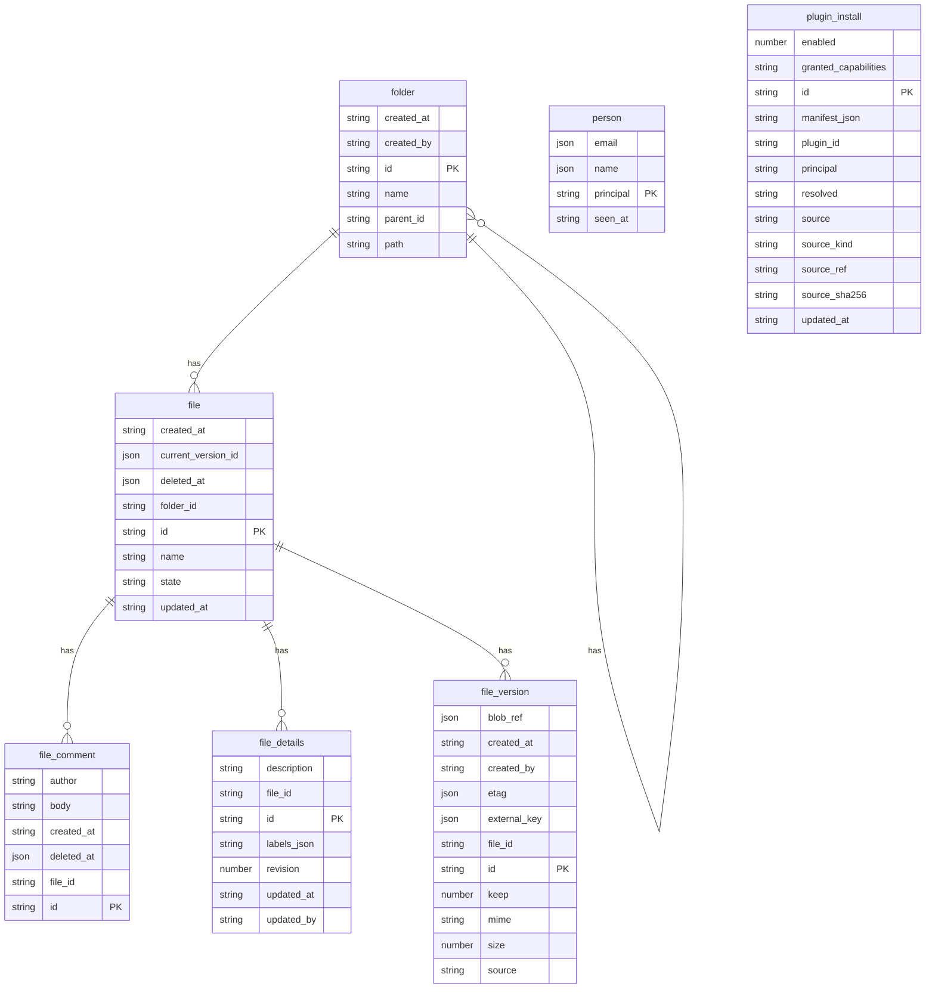

# Drive — a space's files, as a Substrat vertical

> Written after the fact, from the code: `packages/scope-drive/spec/model.ts`, its handlers in
> `src/module.ts`, `src/provision.ts`, and this vertical's worker. It describes what the drive
> does today, so it can be the place a change enters from now on. Where the code and an older
> comment disagree, this follows the code. Where the drive departs from a Substrat standard,
> the standard wins, and *Decided* says what changes.

## 1. What we're building & who uses it

A drive: folders and files, with every version kept, for a **space**. A space is a
household, a family, a small team. It is shared by being a space: whoever is in it can read
everything in it. Nobody has to share each folder one at a time.

People reach it three ways, and all three are the same drive with the same rules:

- **the browser**: browse, upload, preview, edit text, search, Trash, versions;
- **WebDAV** (`/dav/`): Finder and File Explorer mount it with an app password;
- **the assistant** (⌘K): answers questions from documents the person can already read.

One person can be in several spaces, and each one has its own drive.

## 2. The thing that moves through the system

A **file**. Its name and folder are its identity. What it contains is whichever **version**
it currently points at. Writing to a file never overwrites anything. It adds a version and
moves the pointer, so every earlier content can still be opened.

A file is **active** or **trashed**, and it can go back. This is Substrat's standard trash
(K-45): `file` declares `trash: { permission: 'drive:write', purgeAfterDays: 30,
purgeEarly: false }`. The kernel owns the state column, the `trash`/`restore` verbs and the
`entity.trashed`/`entity.restored` events. The drive does not keep its own `state` or
`deleted_at`.

- *active → trashed*: put in the Trash. The bytes and version history stay. Every read
  except the Trash listing behaves as though the file does not exist (`not_found`, never
  "trashed"). The host refuses any operation addressed to a trashed file unless it opts in.
- *trashed → active*: restored to the folder it came from. This cannot conflict, because a
  trashed file keeps its name and nothing else can take that name in the meantime.
- *trashed → gone*: 30 days after trashing, the kernel's purge sweep runs the drive's one
  `trashed: 'purges'` operation, which removes the file, its versions and its bytes.
  `purgeEarly: false` makes 30 days a floor as well as a deadline: nobody empties the Trash
  by hand, so a slip has a month to be undone.

There is no other delete.

Folders do not have a lifecycle. They are created, renamed and moved. The **parent edge** is
what access follows. `path` is derived from it and rewritten under a folder when that folder
is renamed or moved.

There are no stages, so no workflow engine is involved.

## 3. What already exists vs. what's yours

**Free, from the platform:** sign-in through the space's OIDC issuer, the subject→principal
directory, invitations, one Durable Object per space with its own SQLite (the space id is not
a column, it is the database), permission checks on every operation and the walk up parent
edges, grants and their delegation limit, the audit/event outbox, the per-tenant blob store
and its sha256, text extraction and the full-text index, live invalidation frames, kernel
jobs, the model host for AI calls, and hosting.

**Connectors, ours, landed through the kernel:** `canopy.a3doc`. A connector lands one item
at a time through `drive/land-source-change`, which needs `drive:land-source`. No person is
ever granted that key. A file can also be sent the other way (`send-to-source`). Versions held by a connector are `source: 'external'`. The drive has no bytes
for them and says so with a 501 rather than serving an empty file.

**Ours:** folders, files, versions, comments, descriptions and labels, the share projection,
the people roster, plugin installs, WebDAV, app passwords, Document AI, the assistant, and
the offline mirror feed.

## 4. Who can do what

Five keys. They are **independent**: `drive:manage` does not include `drive:write`.

| key | means |
|---|---|
| `drive:read` | see a folder and the files in it |
| `drive:write` | add files and folders, write new versions, rename, move, trash, restore |
| `drive:manage` | share a folder, see who it is shared with, moderate comments; node-wide: administer the space |
| `drive:manage-spaces` | create a new space in this tenant |
| `drive:land-source` | a connector landing items; never a person |

**Being in the space means reading all of it.** Every role holds `drive:read` across the
whole space. A member cannot hold "read only this folder", and the share dialog does not
offer read, because it would change nothing.

**Writing is granted by role or on a folder.** An editor writes anywhere in the space. A
viewer writes only inside folders that were shared with them, and that includes everything
below those folders. A file inherits from its folder, and its folder from that
folder's parent.

**Access moves with the item.** Moving a file into a folder the family can read makes it
readable by the family, because that is what dragging it there means. A move needs write
permission on *both* sides, the folder it leaves and the folder it goes to. Otherwise someone
with write in one folder could pull a file out of a folder they cannot write and give
themselves access to it.

**Sharing is delegation, never elevation.** You can share a folder only if you hold
`drive:manage` on it, and you can hand out only what you hold yourself. The root folder
cannot be shared at all: access to the whole space belongs to roles and the People screen,
not to a grant. Unsharing is limited the same way, so you can withdraw only what you could
have given. Withdrawing a share that does not exist is not an error.

**Node-wide `drive:manage` is administering the space**: managing people, turning on
Document AI, and installing plugins for the whole space. A `drive:manage` grant on one
folder never adds up to that authority.

**Creating another space is its own key**, `drive:manage-spaces`, held only by the owner.
It is the same pattern as Manyfold's `content:manage-sites`: `drive/request-space` checks
it and raises a `provision-sibling` platform intent. It does not borrow `drive:manage`.

**Comments** can be posted by anyone who can read the file. A comment can be deleted by its
author, or by someone holding `drive:manage` on the file.

**Plugins** can be installed by anyone who reads the space, but only for themselves.
Installing, changing or removing a plugin for the whole space needs node-wide
`drive:manage`. Another person's personal install is invisible (`not_found`).

**What a refusal looks like:** a file or folder you cannot read answers the same as one
that does not exist. `folder-by-path` returns null either way. Search, the Trash listing, the
shared-with-me list and the change feed check every row before returning it, so a ranked
list cannot reveal that a document exists somewhere you cannot see.

**Another space, or another tenant, reaches nothing.** The rows are not filtered by space.
They live in a different database.

## 5. Money & sign-off

Neither. Nothing is priced or invoiced, and no step waits for approval.

The closest things to a sign-off are compare-and-swap writes. A text save or a details edit
names the version or revision it started from and is refused with `conflict` if the file
has changed since. The editor keeps the draft.

## 6. The cast, roles, tenancy

**One scope per space, in a tenant.** Spaces are siblings in the tenant's identity
directory, and a login can be in several of them.

| who | where | what they are |
|---|---|---|
| Ada | the family space | `owner`, its owner of record |
| Björn | the family space | `viewer`: reads everything, writes nothing until Ada shares a folder |
| Cleo | the family space | gets `drive:write` / `drive:manage` on one folder ("Papers") and nothing more |
| someone in another tenant | a different scope | must reach nothing, not even the same paths |

Roles (`provision.ts`):

- **owner**: read, write, manage and manage-spaces, across the whole space. Assigned at
  provision. It cannot be invited, and the owner of record cannot be unbound.
- **editor**: read and write, across the whole space.
- **viewer**: read.

`viewer` and `editor` can be invited. Each role is distinct, as Substrat's role sets are.
The legacy `member` role (identical to `viewer`) is retired: existing `member` bindings move
to `viewer`, and only then is `member` dropped from the role table.

**Removing someone** happens in a fixed order: unbind their subject first, then revoke the
folder grants the drive recorded and forget their roster row, then remove their role.
Unbinding comes first because the kernel cannot list grants. Once the subject is unbound it
resolves to no one, so even a grant the drive never recorded stops working.

## 7. The data we'll store

All in the space's own scope. No table has a space id column.

- **Folders**: id, parent, name, the derived full path (unique), who created it, when. The
  root folder (`''`) is created by the migration, so every file has a parent.
- **Files**: folder, name (unique within the folder, trashed files included), and the
  current version. Whether a file is trashed, and since when, is the kernel's
  `_substrat_trashed_at` column on the same row (K-45), not a drive column.
- **File versions**: `blob` (an attachment id; size and type are read from the attachment
  row, never accepted from the caller) or `external` (a connector key and etag, with the
  connector's size and type), plus a `keep` flag for retention.
- **Comments**: file, author, body, a soft delete. The body is erasable.
- **File details**: description and labels, with a revision counter. They are kept apart
  from the file row, which every listing reads.
- **People**: principal → email and name, as last seen at sign-in. This is display
  identity only. It grants nothing and is erasable. It is written only by the worker
  (`record-person` has no route), because only the worker has the verified claims.
- **Folder shares**: which folder, who, which key, granted by whom, when. This copies what
  the kernel granted so the share dialog has something to show. It is never used to decide
  access. If it ever disagrees with the kernel, the copy is the row that grants nothing.
- **Plugin installs**: per person, or `space`. Holds the manifest, source, provenance and
  fingerprint, and the capabilities the installer approved.
- **Source write journal**: attempts to upload to a connector, kept so a failed call can be
  retried. It holds no credentials.

**Stored outside the drive's own tables, in the platform:** bytes (the attachment store),
extracted text and its status (the kernel's index), grants and roles, the subject directory,
app password hashes, and space settings (name, icon, colour, Document AI on/off).

## 8. The screens

- **The drive**: a folder's subfolders and files, paged, with move, rename, upload and
  "New → …" from plugins.
- **Preview**: the file in a trusted or sandboxed viewer, plus tabs for Details
  (description, labels), Versions (open, restore, keep) and Comments. Text can be edited
  for writers when the whole body fits.
- **Search / ⌘K**: matches on name, content and metadata, each hit marked with what
  matched. You can also ask the assistant from here.
- **Trash**: every trashed file the person can read, across the space, with a restore
  button.
- **Shared with me**: folders granted directly to the person in this space.
- **Share dialog**: who a folder is shared with, by name, plus add and withdraw.
- **People**: the roster, invitations, and removal, shown only when `people-access` says so.
- **Space settings**: name, icon, colour, and *Label new uploads automatically*.
- **Plugins**: catalog, local, GitHub, npm and ZIP imports, with capabilities approved at
  install.
- **Connect with WebDAV…**: the server address and app passwords (up to 20, each shown
  once).

## 9. The scenario the test will replay

**The happy path.** Ada creates "Documents" and uploads `report.pdf`. She uploads it again
under the same name, and the result is one file with two versions, the new one current. The
old version still opens with its original bytes. Björn, a viewer, sees the folder and opens
the file. Both find it by a word in its text.

**Sharing.** Björn is refused when he uploads into "Papers". Ada shares "Papers" with Cleo as
`drive:write`, and Cleo can now write there and in every folder under it, but not next to it.
Ada adds `drive:manage`. Cleo can now see who "Papers" is shared with, but holding only
manage would not have let her write. Cleo tries to hand out more than she holds and is
refused. Ada removes Cleo, and afterwards Cleo can do nothing in "Papers".

**Trash.** Ada trashes `report.pdf`. It disappears from the folder, from search and from
direct reads (`not_found`), and appears in the Trash. Uploading a new `report.pdf` into
"Documents" conflicts, because the trashed file still holds the name. Restoring it brings
back the file with all its versions. A file left in the Trash for 30 days is purged by the
sweep, versions and bytes included. Nobody can purge it sooner, Ada included.

**The denials that prove it.**

- A version cannot point at another file's bytes or at bytes that do not exist. A version
  records the size and type that were actually stored, not what the caller claimed.
- A name containing `/` or `\`, or one that is `.` or `..`, is refused rather than joined
  into a path.
- Moving a folder into one of its own descendants is refused.
- A viewer who has no write grant can read the bytes but cannot upload any.
- The root folder cannot be shared.
- An editor cannot create a new space; only `drive:manage-spaces` can.
- A tenant's other scope shares no rows with this one, not even rows at the same paths.
- A control beside each check: Björn *can* read, and Cleo *can* write in "Papers". This
  shows the refusals are not passing simply because everything is refused.

## 10. Assumptions

Decisions the code has already made. Each one is cheap to reverse now and gets more
expensive later.

- Membership is read access to the whole space. Read cannot be narrowed or shared.
- Access follows a move, and a move checks write on both sides.
- `manage` and `write` are independent keys, not a ladder.
- A trashed file keeps its name.
- Trash follows K-45. Trashing is `drive:write`, like every other change to a file. The
  Trash empties itself after 30 days and cannot be emptied sooner.
- The `keep` flag is recorded, but nothing prunes versions yet.
- Any reader may comment, which keeps the old viewer behaviour.
- Uploads are limited to 25 MB, because of isolate memory, not configuration. Text edits are
  limited to 200,000 characters.
- Document AI is off until an administrator turns it on. It never overwrites a label or
  description a person wrote, and never reads `.locked` files.
- The assistant can only read. It reaches exactly what the person could, in every space
  they can enter, and keeps no conversation history.
- Offline mode is view-only: metadata, plus folders a person pins for offline use.
- WebDAV locks are only acknowledged, never enforced, because Finder mounts read-write only
  when it sees lock support.

## 11. Out of scope

Deleting a file before its 30 days are up. Version pruning. Moving between spaces. Copying a folder. Read access
narrower than the space. Public links. Collaborative live editing. Offline writes. Reading
connector-backed bytes, and migrating existing canopy spaces (see
`documentation/planning/scope-model-mapping.md` §3).

## Decided

Each was a question about where the drive differs from Substrat. Each is answered by Substrat
standard. Not built yet; the change list is in the decisions log.

1. **`drive:manage` and deletion.** Deletion is the K-45 trash, under `drive:write`, with a
   30-day purge. `drive:manage` never meant delete. Its manifest description becomes "Share a
   folder, see who it is shared with, and administer the space".
2. **`member` and `viewer`.** A role set has no duplicates. `member` is retired into
   `viewer` (bindings first, definition after).
3. **Creating a space.** It gets its own key, `drive:manage-spaces`, held by `owner`, as
   Manyfold's `content:manage-sites` is.
4. **The `provision.ts` header comment** says the owner holds its keys on the root folder.
   It holds them across the whole space, and root grants are refused. The comment gets
   corrected.

<!-- The three sections below are generated by `substrat concept sync` from model.json and
     PERMISSIONS.md. Do not edit between the markers. -->

## Roles and permissions (generated)

<!-- substrat:roles -->

_No `PERMISSIONS.md` beside `model.json`, so no roles are listed. A vertical in the Substrat repository gets one from `pnpm lint:permissions`; a scaffolded project has no such command yet, so describe its roles in prose until it has._

<!-- /substrat:roles -->

## Entity model (generated)

<!-- substrat:entities -->

<!-- /substrat:entities -->

## Processes (generated)

<!-- substrat:processes -->

_No lifecycle is declared: nothing here moves through stages._

<!-- /substrat:processes -->

## Decisions log

- 2026-10-31: Concept written from the code as it stands (`@canopy/scope-drive` 0.2.0) so the
  drive has a `spec/concept.md` like every other vertical. It records existing behaviour and
  changes none. From here on, a feature enters here first.
- 2026-10-31: Four departures from Substrat standard decided in favour of the standard (see
  *Decided*). The code does not match yet. To change: `file` declares K-45 `trash` and drops
  `state`/`deleted_at` (a data migration moves trashed rows into `_substrat_trashed_at`);
  trash/restore/list-trash derive from the kernel, and a `trashed: 'purges'` operation is
  added. The change feed and offline mirror read `entity.trashed`/`entity.restored`. New key
  `drive:manage-spaces` on `owner`, checked by `request-space`/`space-requests`. `member` is
  removed from `INVITABLE_ROLE_KEYS`, its bindings move to `viewer`, then it is dropped from
  `ROLES`. The `drive:manage` description and the `provision.ts` header are corrected. The
  permission changes are a human checkpoint.
